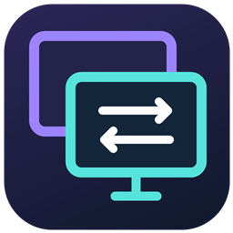
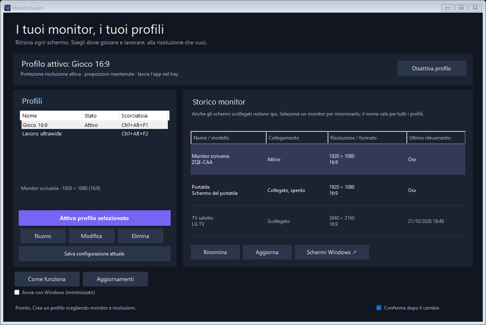

<p align="center">
  
</p>

<h1 align="center">MonitorSwitch</h1>

<p align="center">Your Windows display profiles, one click away.</p>

<p align="center">
  <a href="https://github.com/carellice/MonitorSwitch/releases/latest"></a>
  <a href="LICENSE"></a>
  
</p>

<p align="center">
  <strong><a href="https://github.com/carellice/MonitorSwitch/releases/latest/download/MonitorSwitch-portable-win-x64.zip">Download portable ZIP</a></strong>
  &nbsp; · &nbsp;
  <a href="https://github.com/carellice/MonitorSwitch/releases/latest/download/MonitorSwitch.exe">Download standalone EXE</a>
  &nbsp; · &nbsp;
  <a href="https://github.com/carellice/MonitorSwitch/releases">All releases</a>
</p>

MonitorSwitch is a small, open-source Windows utility for switching between monitor setups. Keep a duplicated display layout for gaming, an ultrawide external monitor for work, or an extended desktop, and switch with a button or a global shortcut.

**Windows 10/11 x64 · Portable · No administrator rights required · Interface currently in Italian**



## Download and run

1. Download **[MonitorSwitch-portable-win-x64.zip](https://github.com/carellice/MonitorSwitch/releases/latest/download/MonitorSwitch-portable-win-x64.zip)** from the latest release.
2. Extract the ZIP and open `MonitorSwitch/MonitorSwitch.exe`.
3. Choose a profile and confirm the display change within 20 seconds.

The [standalone EXE](https://github.com/carellice/MonitorSwitch/releases/latest/download/MonitorSwitch.exe) is also available. No installer is needed. The application uses the .NET Framework included with Windows; it has no external runtime packages. Display switching works offline; checking and downloading updates connects to GitHub.

Release downloads include SHA-256 checksums in `SHA256SUMS.txt`. Binaries are currently unsigned.

## Features

- **In-app updates:** check stable GitHub releases, verify the executable SHA-256 and version, and update the portable executable on restart while keeping profiles.
- **Display modes:** duplicate, extend, laptop display only, or external displays only.
- **Custom profiles:** names, global shortcuts, active monitors and saved layouts.
- **Per-monitor resolutions:** choose a suggested resolution or enter dimensions manually. Extended displays can use different resolutions; duplicated displays share one desktop resolution.
- **One-button switch:** select two profiles and alternate between them with a button or shortcut.
- **Tray operation:** keyboard shortcuts and tray-menu actions leave the main window hidden. With confirmation enabled, only the temporary confirmation dialog appears.
- **Start with Windows:** optionally launch directly in the tray at sign-in, with global shortcuts ready and no main window appearing.
- **Capture your layout:** save monitor arrangement, desktop resolutions, orientation, refresh rates and physical signal timings from the current Windows configuration.
- **Rollback protection:** unconfirmed changes revert automatically. A separate recovery process handles a timeout or app exit during a pending change.
- **Optional immediate switching:** once profiles are verified, disable confirmation for a one-click change.
- **Small and lightweight:** no installer, service, continuous display polling or background capture.

Confirmed changes remain active when the application closes. Minimize the window to keep global shortcuts available in the tray.

## Quick start

The default profiles are **Gioco** (gaming/duplicate), **Lavoro** (work/external displays), **Due schermi** (extend) and **Solo portatile** (laptop only). On first launch, an existing duplicated layout is captured as the gaming profile.

| Default shortcut | Action |
| --- | --- |
| `Ctrl+Alt+F1` | Gioco |
| `Ctrl+Alt+F2` | Lavoro |
| `Ctrl+Alt+F3` | Due schermi |
| `Ctrl+Alt+F4` | Solo portatile |
| `Ctrl+Alt+F10` | Switch between the selected pair of profiles |

All shortcuts are customizable. To edit resolutions, select a profile, click **Modifica**, enable **Personalizza monitor e risoluzioni**, and select or type the dimensions for each display.

For a precise existing arrangement or refresh rate, configure the displays in Windows and use **Salva configurazione attuale**. The app works with the adapter that drives each display, including Intel/NVIDIA hybrid laptops.

Full instructions: **[Italian guide](LEGGIMI.txt)** · **[English portable guide](PORTABLE.txt)**.

## Starting with Windows

Enable **Avvia con Windows (minimizzato)** in the main window or tray menu. At your next Windows sign-in, MonitorSwitch starts hidden near the clock, with global shortcuts active. Double-click its icon to open the window. Disable the same option to remove automatic startup. The option is off by default and applies only to your Windows account; no administrator rights are needed.

Keep the portable EXE in a permanent location before enabling startup. If you move or rename it, open it from the new location and disable/re-enable this option to register the new path. Windows Task Manager can also disable startup apps; re-enable MonitorSwitch there if necessary. Automatic startup does not apply a display profile.

## Updating from the app

Click **Aggiornamenti** in the main window or tray menu, then **Scarica e riavvia** when a newer stable release is available. The app downloads `MonitorSwitch.exe` from this repository's GitHub release, checks its API-provided SHA-256 digest, Windows x64 executable header and embedded version, and starts a temporary updater. It waits for the app to close, replaces the executable and restarts it. Profiles are preserved; an app that was in the tray restarts in the tray.

The tray option **Controlla aggiornamenti all'avvio** enables or disables automatic startup checks. Successful automatic checks are limited to once every 24 hours; manual checks are always available. Updates are installed only after the user clicks **Scarica e riavvia**. No GitHub account or token is required.

The previous executable is kept next to the app as `MonitorSwitch.exe.previous` (or the corresponding name if you renamed the EXE). If the new process exits before startup is confirmed, that executable is restored. Files are staged in `%LOCALAPPDATA%\MonitorSwitch\updates`. The application folder must be writable. SHA-256 verifies release integrity; binaries are not Authenticode-signed.

**Version 2.1.0 and earlier need one manual download of version 2.2.0 or later to gain the updater.** Subsequent stable releases can be installed from within the app.

Release maintainers: keep the standalone asset named `MonitorSwitch.exe`, and make the version tag agree with the embedded executable version. The updater requires GitHub's SHA-256 asset digest.

## Requirements and limitations

- Windows 10/11 x64 with .NET Framework 4.x.
- Display modes must be accepted by the Windows graphics driver. Monitor availability and supported modes depend on the hardware and connection.
- Duplicating displays does not guarantee a 16:9 image; the common resolution and monitor/driver scaling determine the result.
- HDR, VRR, DPI scaling, brightness, color profiles and in-game settings are not managed.
- Profiles normally recognize the same monitors across reboots. Changing ports, docks or drivers may change device identities and require capturing a profile again.
- The app does not emulate a monitor or hide resolutions from games.

## Build and test

On Windows, with the .NET Framework compiler included with the OS:

```powershell
.\build.ps1
```

The executable is generated at `dist/MonitorSwitch.exe`. To build, run the self-tests and create the release packages:

```powershell
.\release.ps1
```

Packages and SHA-256 checksums are written to `release/`. Self-tests do not apply display changes. The application uses C#, Windows Forms and native Windows display APIs; there are no external runtime packages.

The automated suite covers profile persistence, shortcut conflicts, monitor/source assignment, clone and extend layouts, per-monitor resolution editing, recovery behavior, tray visibility and native structure layouts. Driver validation checks a proposed configuration without applying it; physical display behavior still requires hardware testing.

The updater is also tested with isolated executable stubs using `tools/test-updater.ps1`, covering parent exit, file replacement, restart receipt, tray state and the retained previous executable. A separate live download check verifies GitHub API access, HTTPS redirects, SHA-256 and embedded version without installing or executing the download.

Push a version tag such as `v2.2.0` to run the Windows build, tests and automatic GitHub release workflow. See [CONTRIBUTING.md](CONTRIBUTING.md) for development notes.

## Settings and recovery data

| File | Purpose |
| --- | --- |
| `%LOCALAPPDATA%\MonitorSwitch\profiles.xml` | Profiles, shortcuts and preferences |
| `%LOCALAPPDATA%\MonitorSwitch\pending-display.bin` | Backup for an unfinished display change |
| `%LOCALAPPDATA%\MonitorSwitch\errors.log` | Error diagnostics |

Do not delete a pending backup before recovery. If the original monitors were disconnected during a change, reconnect them and reopen the app. Review logs for personal information before posting them publicly.

## License

[MIT](LICENSE) © 2026 carellice.
